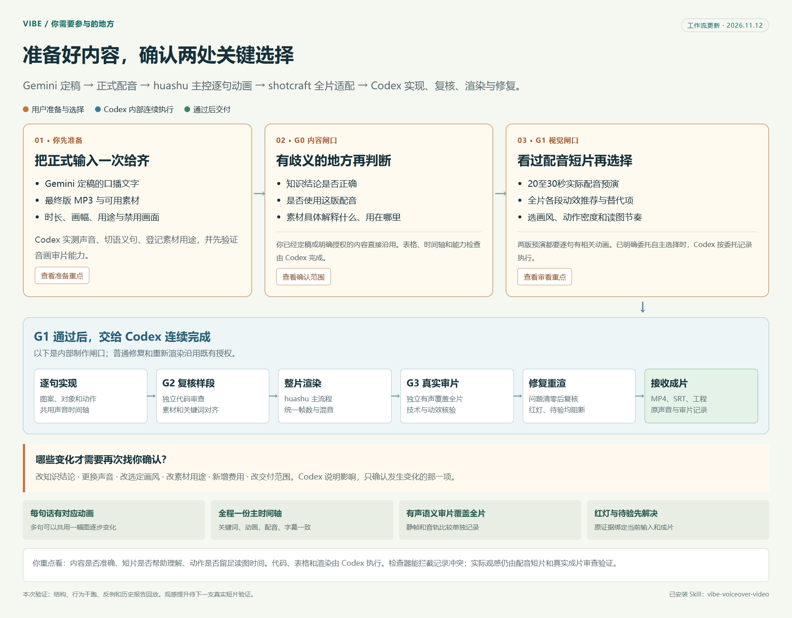

# FitCal

FitCal 是一个饮食与运动热量管理 Web 应用。记录按日期保存在当前浏览器，餐食照片通过服务端 OpenAI API 识别，识别结果必须由用户确认后才会计入当天数据。

## 本地运行

1. 在项目根目录创建 `.env.local`，设置 `OPENAI_API_KEY`。
2. 运行 `npm run dev`。
3. 打开 `http://127.0.0.1:5173`。

## Vercel 部署

- Framework Preset: `Other`
- Build Command: `node scripts/build-static.js`
- Output Directory: `dist`
- Environment Variable: 将 `OPENAI_API_KEY` 作为 Secret 添加到 Production；如需预览环境识别，也同时添加到 Preview。

环境变量变更后需要重新部署。API 密钥只允许保存在本地环境文件或 Vercel Secret 中，不要提交到 Git。

## 数据说明

- 饮食、运动、目标和日期记录保存在浏览器 `localStorage`。
- 餐食照片会压缩后发送用于单次识别，不写入本地记录。
- 热量和营养数据为估算值，仅作健康管理参考。

## 视频复刻 Skill 套件

[查看安装说明与完整套件目录](docs/video-replica-jiangling/README.md)。三个配套 Skill 分别位于 `skills/video-replica-jiangling`、`skills/video-depth-anything` 和 `skills/qisi-video-remix`，使用者需要自行准备深度模型环境并配置个人 Quan MCP。

## Quan 故事工坊 Skill

[quan-story-studio](skills/quan-story-studio/README.md) 将历史人物口播稿、Quan 配音与配图整理成可编辑的剪映草稿。每位使用者需配置自己的 Quan MCP、API 凭据和授权参考 MP3。技能提供本地预检，缺少个人配置时会停止生成。

[查看鲁班打磨报告](docs/quan-story-studio/LUBAN_REPORT.md)。

## Vibe 口播视频 Skill

[查看 Vibe 口播视频工作流](skills/vibe-voiceover-video/README.md)：使用定稿文稿、正式 MP3 与素材制作逐句动画视频，先试片，再按同一时间轴完成成片。

安装与四 Skill 分享包说明见 [INSTALL.md](skills/vibe-voiceover-video/INSTALL.md)。
