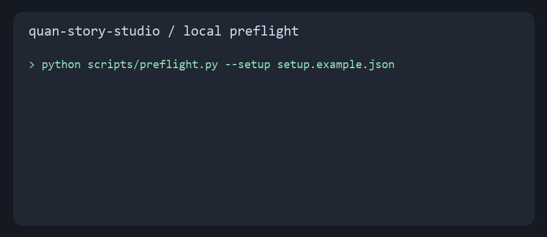

# Quan 故事工坊

把历史人物口播稿、你自己的 Quan 音色和配图接成可编辑的剪映草稿。

输入是一篇定稿、本人授权的参考 MP3、本人 Quan 账户和本机剪映环境。输出包括分镜、竖屏配图、字级时间轴、拼版复核图及剪映草稿。批量生图会消耗 Quan 额度。

## 安装

把本目录复制到 Agent 的 Skill 目录，例如 Codex 的 `~/.codex/skills/quan-story-studio`。如果本目录放在公开仓库的根目录，也可运行：

```bash
npx skills add https://github.com/yokadanye-prog/danye-mvp --skill quan-story-studio --agent codex --copy --yes
```

安装后，按 [个人配置说明](references/setup.md) 配置自己的 Quan MCP、API 凭据、参考 MP3 和音色 ID。在技能目录复制 `setup.example.json` 为 `.quan-story.local.json`，填写后从技能目录运行：

```bash
python scripts/preflight.py --setup .quan-story.local.json
python scripts/quan_story.py doctor
```

配置检查只验证本地状态。真正生成前还要在当前 MCP 连接中核对音色与模型。缺任一项时，生成会停在准备阶段。



这段演示由 `python examples/render_demo.py` 从实际预检输出生成。示例配置故意留空，不涉及真实账号或额度。

## 安装后可以这样说

> 用 quan-story-studio 根据我项目里的《正文.md》做一期历史人物口播。先检查我自己的 Quan MCP、参考 MP3 和音色 ID，再给我三档镜数建议和画面方向。

## 六步产物

| 步骤 | 输入 | 产物 |
| --- | --- | --- |
| 定稿 | 选题或现有文稿 | `正文.md` |
| 配音 | 文稿、本人 Quan 音色 | `配音正式/人物_完整版.mp3` |
| 分镜 | 配音、转录、文稿 | `分镜/STORYBOARD.json` |
| 生图 | 确认后的分镜 | `配图/S001.png` 等及拼版图 |
| 时间轴 | 配音、配图、分镜 | `edit/plan.json` |
| 剪映草稿 | 经验证的时间轴 | 可编辑的剪映草稿 |

运行步骤与命令见 [SKILL.md](SKILL.md)。脚本以 Windows 剪映环境为主要验证对象，其他系统的草稿路径需自行核对。

## 安全与费用

仓库不包含令牌、MCP 配置、参考 MP3 或可借用的音色 ID。`preflight.py` 不发网络请求，不打印令牌。Agent 只使用当前用户启用的 Quan MCP。音色应取得录音者授权。Quan 配音和生图可能收费，镜数及重生成由用户确认。

这个 Skill 的时间轴脚本可本地运行。Quan 生成能力取决于每位使用者的账户、额度和 MCP 工具。剪映草稿的最终可用性需在剪映中打开验收。

## 同行与方法参考

分段配音与时间轴可参考 [hyperframe-video-production](https://github.com/LeslieLeung/skills/blob/main/skills/hyperframe-video-production/SKILL.md)。本技能保留历史人物竖屏、字级时间戳和剪映草稿的专门流程。
