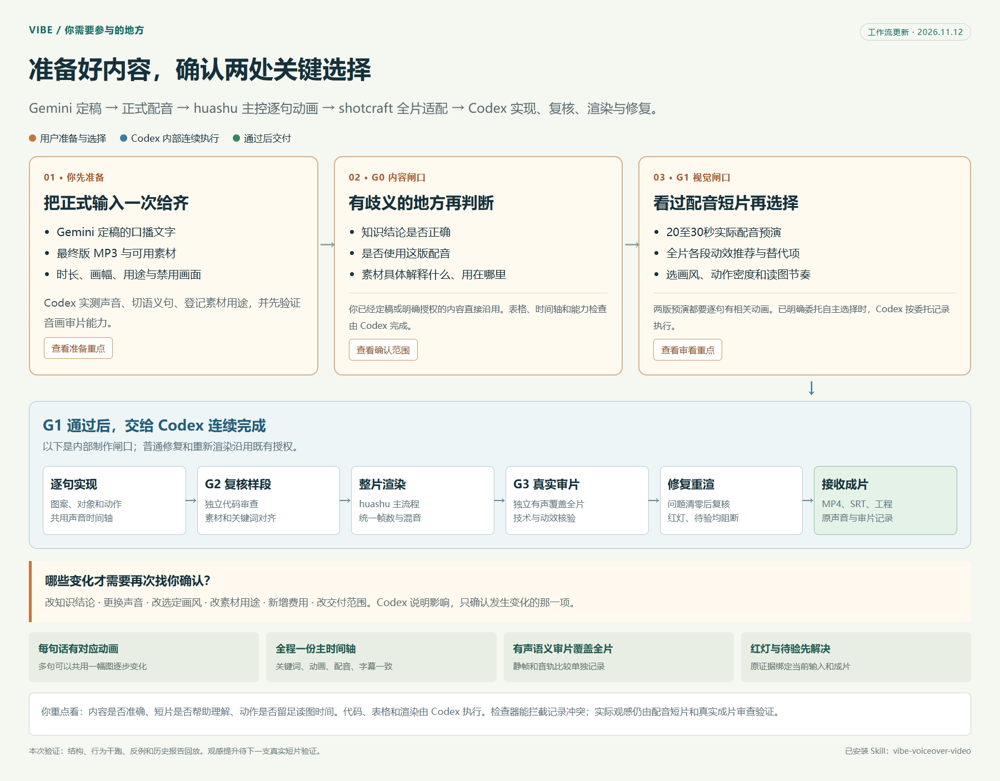

# Vibe 口播视频工作流

> 每句口播都有能解释它的图案动画，整片投入前先看到正式配音效果。

Gemini 写稿并由用户定稿。Codex 全程执行，huashu 主控画面、复核与主渲染，shotcraft 提前适配全片动效。两次前置选择后，代码检查、渲染和普通修复连续进行。



## 开始使用

合并到仓库默认分支后，可单独安装主 Skill：

```sh
npx skills add yokadanye-prog/danye-mvp --skill vibe-voiceover-video -g -y
```

完整四 Skill 套件使用分享压缩包安装，见 [INSTALL.md](INSTALL.md)。

已定稿口播和正式 MP3 到逐句动画视频。使用时需同级安装 `huashu-art-motion` 与 `video-shotcraft`。分享套件还包含可选的 `huashu-motion`。项目记录检查器只用 Python 3 标准库；渲染依赖按所选引擎安装。完整安装说明见 [INSTALL.md](INSTALL.md)。

```text
使用 $vibe-voiceover-video，定稿、正式 MP3 与素材在我的项目中。
由 Codex 全程完成，huashu 主控，shotcraft 先给全片动效适配和推荐。
每句都有相关图案动画，先看20至30秒真实配音试片，再制作完整成片。
```

## 用户需要做什么

准备定稿、配音、素材及特别要求；G0 只核准有歧义的含义或用途，已有确认沿用；G1 看真实短片，选画风、动效和节奏。G2/G3 检查、渲染与普通修复由 Codex 完成。实质改变原选择或新增费用时才需要新决定。

## 产物与项目文件

交付配音试片、全片适配表、逐句分镜、净画 MP4、SRT、原配音、源码与验收证据。可打开 [交互流程图](assets/user-workflow.html)。

| 文件 | 用途 |
|---|---|
| `project.json`、`CUE_TIMELINE.csv` | 正式输入、声音与主时间轴 |
| `ASSET_ROLES.csv` | 素材含义、权限与处理 |
| `SHOT_SCRIPT.csv` | 一句一行的对象、动作、关键词和停留 |
| `MOTION_ADAPTATION.csv`、`MOTION_BUDGET.csv`、`STYLE_LOCK.md` | 全片适配、推荐与视觉锁定 |
| `RENDER_MANIFEST.csv`、`ASSET_USAGE.csv` | 从实际实现导出的动作引用与素材可见区间 |
| `GATES.json`、`qa/`、`审片/` | 决策、证据、实际媒体与语义审片记录 |

字段及模板见 [数据契约](references/project-contract.md)，这些表格由 Codex 生成。

## 检查与示例

```bash
python scripts/check_project.py --project <项目> --fingerprint
python scripts/check_project.py --project <项目> --gate G2
python scripts/check_project.py --project <项目> --gate G3 --report <项目>/qa/release-check.json
python -m unittest discover -s tests -p "test_*.py"
```

检查器只读取项目及证据，可按显式参数写报告。它检查记录、时间、引用和哈希，无法自动证明图像含义或用户真实意图，实际媒体检测和有声审片仍必需。示例与反例见 [测试说明](examples/README.md) 和 `tests/test-prompts.json`。

## 边界与效果

沿用正式音频与现有素材。新增费用、换声与对外发布须已有授权。公共 Skill 仅在明确要求下更新。规则与检查器可通过结构、反例和历史报告验证；视频观感提升仍需下一支真实配音短片证明。

## 参考

[huashu-art-motion](https://github.com/alchaincyf/huashu-art-motion)、[video-shotcraft](https://github.com/Vincentwei1021/video-shotcraft)、[huashu-motion](https://github.com/alchaincyf/huashu-motion)、[Remotion 官方技能](https://github.com/remotion-dev/skills)、[Motion Canvas](https://github.com/motion-canvas/motion-canvas)、[Manim](https://github.com/ManimCommunity/manim)。
