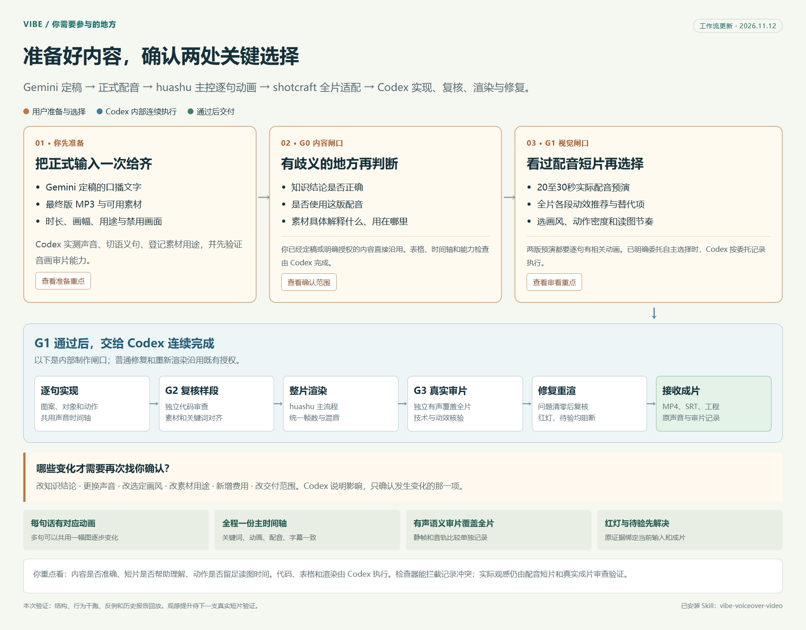

# Vibe 口播视频制作

**一句口播，对应一个能解释它的画面事件。** Gemini 提供用户已定稿的口播，用户提供正式配音与素材，Codex 统一完成制作、审查、修复和交付。`huashu-art-motion` 主控逐句画面、动画语法、代码复核与主渲染流程；`video-shotcraft` 在视觉锁定前适配全片动效，提供镜头卡与工作台。两个 Skill 都由 Codex 执行。外部模型协作仅在用户另有明确安排时加入。



[查看流程图大图与交互版](README.md#用户需要做什么)。

## 首先读取

1. 盘点稿件、正式配音、素材、既有确认与特别用途。沿用原音频，新增付费素材或更换声音须已有授权。缺少最终配音时先处理事实和素材，取得声音后再锁时间。
2. 读取同级 `huashu-art-motion/SKILL.md`、其 `references/12-口播整片与经验回流.md` 和 `video-shotcraft/SKILL.md`，按选型读具体语法、镜头卡与准确 demo。用户说的 `video-shortcraft` 按 `video-shotcraft` 核对具体目录。
3. 读取 [前期与试片](references/pilot-and-gates.md)、[数据契约](references/project-contract.md)，试片放行后读 [全片制作](references/full-production.md)。每片独立保存规则和证据，项目文件见 [README](README.md)。

## 逐句动画与唯一时间轴

- 按实际录音切分语义句并取得句级时间，关键词另设锚点。SRT 行不直接当作语义句，字数均分不能替代声音对齐。
- **每个语义句都要有相关图案或对象动画。** 写明对象、关系、可见动作、动作时间与读图停留。相邻句可共用一景逐步变化，“暂停”可对应对象冻结。纯文字换页、无关粒子、通用扫屏或全员呼吸循环不能满足逐句动画要求。
- 实操句保留真实界面与可见操作，动画用于解释对象或关系。示意图标明示意，截图不能冒充鼠标操作或完整播放证据。
- 配音、动画、镜头、字幕与最终渲染共用句 ID 和主时间轴。huashu 主流程接入 shotcraft 配方或同帧率、准确帧数的预渲染镜头，统一一次最终合成。

## 四个闸口

| 闸口 | Codex 工作 | 用户参与 | 放行条件 |
|---|---|---|---|
| G0 内容、声音、素材 | 校正时间、登记素材职责，以10秒素材实测同步音画审片能力 | 只确认有歧义的知识、声音或用途，沿用已有确认 | 输入一致、职责明确、审片能力有实际证据 |
| G1 全片适配、分镜、试片 | huashu 写逐句画面，shotcraft 给全片动效推荐，渲20至30秒正式配音预演 | 看短片，选画风、动效组合与节奏 | 全句映射、全片适配表、样式、预算及选择记录齐全 |
| G2 代码与高风险样段 | 代码复核、运行引用检查，渲开头、密集段、实操、指定素材段与结尾 | 常规检查与修复连续执行 | 句级映射100%，素材、动作、时间正确，样段问题清零 |
| G3 真实成片 | 独立 Codex 有声审片、技术检查、修复重渲与复核 | 完成后接收成片 | 语义覆盖全片、自动门禁无红灯、阻断问题清零 |

已有明确授权直接应用。用户明确委托自主选择时，G0/G1 记录委托并自主决定。用户只要试片时停在试片交付；已有全片制作请求时，G1 方向确认承接后续制作授权。缺少必要输入或审片能力时标明缺口，继续清点、分镜等独立工作，补足后再完整渲染。只有知识结论、已选方向、声音、素材职责或新增费用等实质变化需要新的判断，G2/G3 不成为反复确认渲染命令的环节。

## G1 先让用户看到效果

给出全片各段的语法、镜头卡推荐、替代选项、适配原因及可看的动态参考。没有合适卡的段落由 huashu 承接，仍登记在全片适配表。选卡须查 `gallery/api/library.json`、读卡全文和准确 demo，不能凭卡名重写。

先给代表图解、真实界面和素材展示的静帧，再用容易错配的20至30秒正式配音预演。默认推荐版与对照版同内容、同声音、同时间，两版均满足逐句动画。用户已指定一种试片时按要求执行。每镜一个主要动作，落定后保留读图时间。

主要动作上限写入预算；正文或配音对齐试片段最多两次大面积主要动作，逐句的小范围对象变化持续保留。同款显眼全屏转场默认整片最多两次。门禁提示动作不足时，回到讲解对象设计变化，禁止批量补同款扫屏。

## 放行须有证据

按 [契约](references/project-contract.md) 写 `GATES.json`，输入、方案、代码和报告绑定文件哈希。运行：

```text
python <skill>/scripts/check_project.py --project <项目> --gate G2
python <skill>/scripts/check_project.py --project <项目> --gate G3 --report <项目>/qa/release-check.json
```

只读检查器验证字段、时间、引用、哈希和放行记录，不能代替语义判断、实际媒体探测或有声审片。独立审查者只报问题，由制作 Codex 修复。连续有声观看或连续分段覆盖全片均可；抽帧和音轨相关性单独记录，语义项保持待验。

红灯、能力待验或阻断问题存在时，只能保留候选与问题报告。修复后重渲、复核并重跑检查。输入、方案、代码或成片变化后，受影响旧证据须重做。不能通过改报告状态、降阈值或重复全屏动作取得放行。

## 默认交付

无内嵌口播字幕的配音 MP4、同源 SRT、原配音、源码、实际运行引用清单与审片记录。校对版可显示字幕，交付版关闭文字与底条、预留字幕安全区。配乐按已选方案后置混合并避让人声。用户有其他字幕或音轨要求时按约定验证。

核对文件存在，给可打开的链接与本地位置。按 shotcraft 参考打开动效工作台；需要剪映工程时验证当前系统兼容性。默认不自动对外发布；公共 Skill 仅在用户明确要求修改时更新。
